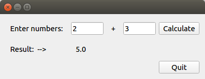
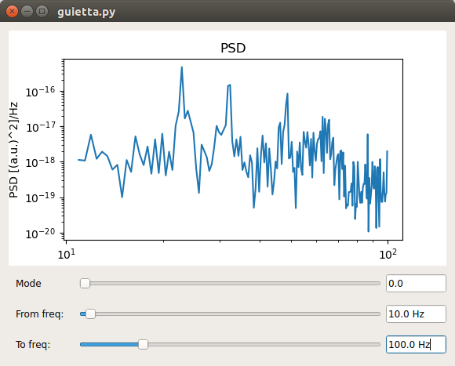

Guietta!
========

Guietta is a tool that makes simple GUIs *simple*::

    from guietta import _, Gui, Quit
    
    gui = Gui(
        
      [  'Enter numbers:', '__a__'  , '+' , '__b__',  ['Calculate'] ],
      [  'Result:  -->'  , 'result' ,  _  ,    _   ,       _        ],
      [  _               ,    _     ,  _  ,    _   ,      Quit      ]
    )

    with gui.Calculate:
        gui.result = float(gui.a) + float(gui.b)
    
    gui.run()

And here it is:

Also featuring:
 - matplotlib and pyqtgraph integration, for easy event-driven plots
 - easily display columns of data in labels using lists and dicts
 - multiple windows
 - customizable behaviour in case of exceptions
 - queue-like mode (a la PySimpleGUI)
 - integrate any QT widget seamlessly, even your custom ones (as long as
   it derives from QWidget, it is OK)
 - easy background processing for long-running operations
 - ordinary QT signals/slots, accepting any Python callable, if you really
   want to use them
 
Installation
============

Using Conda
+++++++++++

Guietta is available on the conda-forge community channel:

 **conda install -c conda-forge guietta**

*Warning*: if you are managing your environments with Conda, install
the Qt binding with conda too, not with pip (`details <qt_conda.html>`_).

Using Pip
+++++++++

Guietta works with any of the PySide6, PyQt6, PyQt5 and PySide2 Qt
bindings, through `QtPy <https://pypi.org/project/QtPy/>`_. No binding is
installed automatically, so you can choose the one you prefer.
If you do not have one already, install guietta together with a binding::

    pip install guietta[pyside6]

(or ``guietta[pyqt6]``, ``guietta[pyqt5]``, ``guietta[pyside2]``).
If a Qt binding is already installed, just use **pip install guietta**.

Selecting the Qt binding
++++++++++++++++++++++++

If more than one binding is installed, select one by setting the
``QT_API`` environment variable to ``pyside6``, ``pyqt6``, ``pyqt5``
or ``pyside2``.

Screenshots
===========

Guietta at work in a scientific lab, showing an interactive plot.

Tutorial
========

Direct link to the tutorial: `tutorial.html <tutorial.html>`_.

See also the rest of the `documentation <index.html#id1>`_ below.

Source code
===========

https://github.com/alfiopuglisi/guietta

Troubleshooting
===============

Guietta uses Qt, and some Linux distributions, like Ubuntu 16.04, appear
to have an incomplete default installation. If you encounter trouble
running guietta, please read the
`troubleshooting guide <troubleshooting.html>`_.

Documentation
=============

.. toctree::
   :maxdepth: 1

   intro
   tutorial
   reference
   internals
   changelog_link

